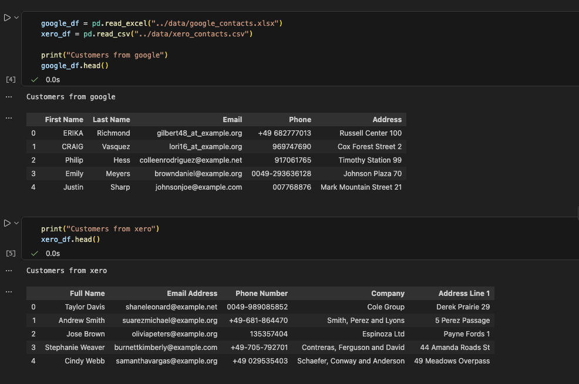
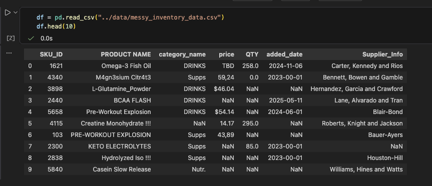
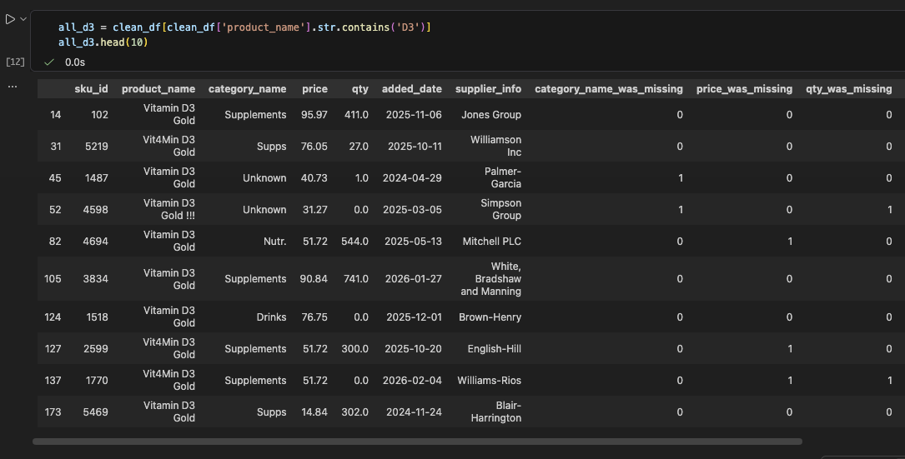
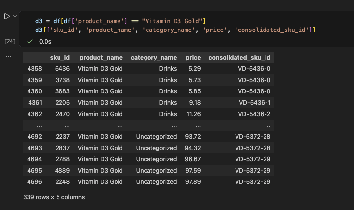
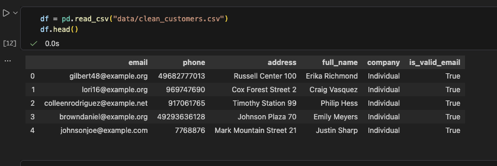
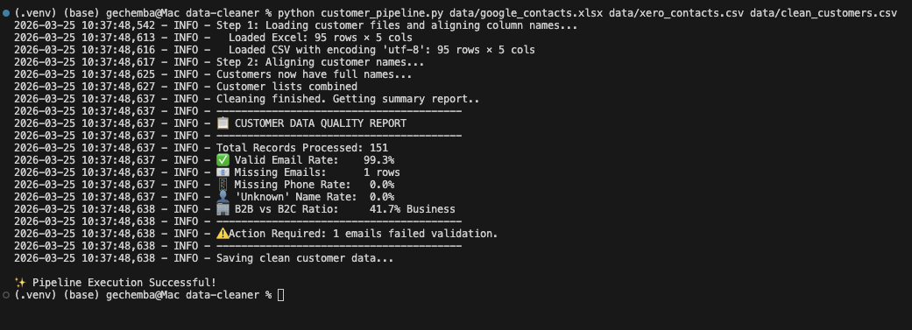

# Customer & Product Data Standardization & Entity Resolution Pipeline

**A modular Python pipeline for transforming messy, multi-source data into unified, analysis-ready master datasets.**


### Executive Summary

Built a production-style data pipeline to cleans, standardizes, and unifies fragmented customer and product data across multiple systems. The pipeline applies both base data cleaning and business logic (entity resolution, SKU consolidation) to produce reliable master datasets suitable for reporting and downstream applications.

______

## Overview

Businesses often operate with fragmented data across systems (e.g., CRM, accounting, inventory), leading to duplicate records, inconsistent schemas, and unreliable reporting.

This project builds a modular data pipeline that transforms messy, multi-source data into **clean, unified “master” datasets** for customers and products.

*****

## Business Problem

### Customer Data

- Multiple sources (Google Contacts, Xero) with:

    - Different schemas (e.g., Email vs Email Address)

    - Inconsistent formats (phones, emails, names)

    - Duplicate records across systems

**Problem**: No single source of truth for customers

### Product / Inventory Data

- Same product stored under multiple names:

    - Vit4Min D3 Gold, Vitamin D3 Gold, Vitamin_D3_Gold

- Inconsistent categories and formats

- Mixed price formats (**e.g., 59,24, $46.04, TBD**)

**Problem**: Broken inventory tracking and inaccurate reporting

____

## Solution

The pipeline consists of two layers:

### 1. Base Cleaning (Data Hygiene)

- Standardizes column names and formats
- Cleans text, dates, prices, emails, and phone numbers
- Removes duplicates and invalid entries

### 2. Business Logic (Entity Resolution)

- Aligns schemas across data sources
- Deduplicates customers using email and fuzzy matching
- Consolidates product SKUs from name variations
- Maps inconsistent categories to a controlled taxonomy

______

## Key Outcomes

- Unified customer dataset with consistent schema across sources  
- Consolidated duplicate products into single master SKUs and product names  
- Standardized critical fields (price, phone, email)  
- Reduced data fragmentation and improved reporting reliability  
- Enabled downstream analytics and database integration  

_____

## Sample Transformation

### Before Cleaning (fragmented data)

- Multiple product names for same item

- Inconsistent customer schemas

- Mixed formatting (emails, phones, prices)

Google and Xero customer data before cleaning showing inconsistent headers (e.g., "Email Address vs Email", "Address vs Address Line 1"), inconsistent phone and email entries (e.g., gilbert48_at_example.org vs johnsonjoe@example.com, +49-681-864470 vs 969747690)




Inventory before cleaning showing inconsistent format (e.g., underscores), typos (e.g., numbers replacing letters like 3 for e, 4 for a), mixed header naming (some in upper others in lower cases) and subtle differences in spacing or naming that refer to the same item e.g., Vitamin D3 Powder appears under slightly different names and typos:
    - Vit4Min D3 Gold
    - Vitamin D3 Gold 
    - Vitamin_D3_Gold  



After running the first pipeline before business specific pipeline 2:




### After Cleaning (Master Data)

- One product → one standardized name + SKU

- One customer → one unified record

- Fully structured and analysis-ready datasets

A clean inventory table where identical products are consolidated under one standard master name and SKU e.g., Vitamin D3 Powder:




A uniform customer table where every row only has full_name, email, phone, address, and company



______

## Data Quality Reporting

The built-in *Data Health Monitors* generate summary reports to ensure transparency in the cleaning process.

e.g., 

- What percentage of the company's customers are businesses
- Flags customers with invalid / no email address instead of deleting them so the team can go back and fix later rather than losing the lead entirely.

```plaintext
----------------------------------------
📋 CUSTOMER DATA QUALITY REPORT
----------------------------------------
Total Records Processed: 151
Valid Email Rate:    99.3%
Missing Emails:      1 rows
Missing Phone Rate:   0.0%
'Unknown' Name Rate:  0.0%
B2B vs B2C Ratio:     41.7% Business
----------------------------------------
⚠️ Action Required: 1 emails failed validation.
----------------------------------------
```

Example successful CLI transformation



_____

## Project Structure
```plain text

data-standardization-pipeline/
├── etl/        
│   ├── loaders.py          
│   └── savers.py           
|
├── cleaners/                      
│   ├── string_cleaner.py   
│   ├── price_cleaner.py    
|   ├── numeric_cleaner.py  
|   ├── column_names.py     
│   └── deduplicator.py     
|
├── deep_clean/                     
│   ├── category_logic.py   
│   ├── product_logic.py    
│   └── sku_logic.py        
|
|── notebooks/
│   ├── cleaning_products.ipynb         
│   └── cleaning_customerlist.ipynb 
|  
├── base_cleaning.py        
├── pipeline2.py            
├── customer_pipeline.py    
├── .gitignore
├── README.md
└── requirements.txt   
```

_____

## Architecture

The project follows a modular pipeline design:

- **ETL layer** → data ingestion and persistence  
- **Cleaning modules** → reusable data transformation functions  
- **Business logic layer** → entity resolution and domain rules  
- **CLI orchestration** → reproducible pipeline execution  

Designed for scalability, reuse, and maintainability.

_____

## Usage

1. Installation

```bash
pip install -r requirements.txt
```

2. Run the base cleaning pipeline:

```bash
python base_cleaning.py --input data/raw_data.csv --output data/clean_data.csv
```

3. Running the Customer Pipeline

```bash
python customer_pipeline.py data/google_contacts.xlsx data/xero_contacts.csv data/clean_customers.csv
```

_____

## Repository Note

This repository is a technical showcase.

- Orchestration & ETL: Full source code provided.

- Cleaning Logic: Core algorithms (fuzzy matching, obfuscation recovery) are kept private.

- Reproducibility: To view the results of the private modules, please see the pre-rendered outputs in the notebooks/ folder or the screenshots in the assets/ directory.
